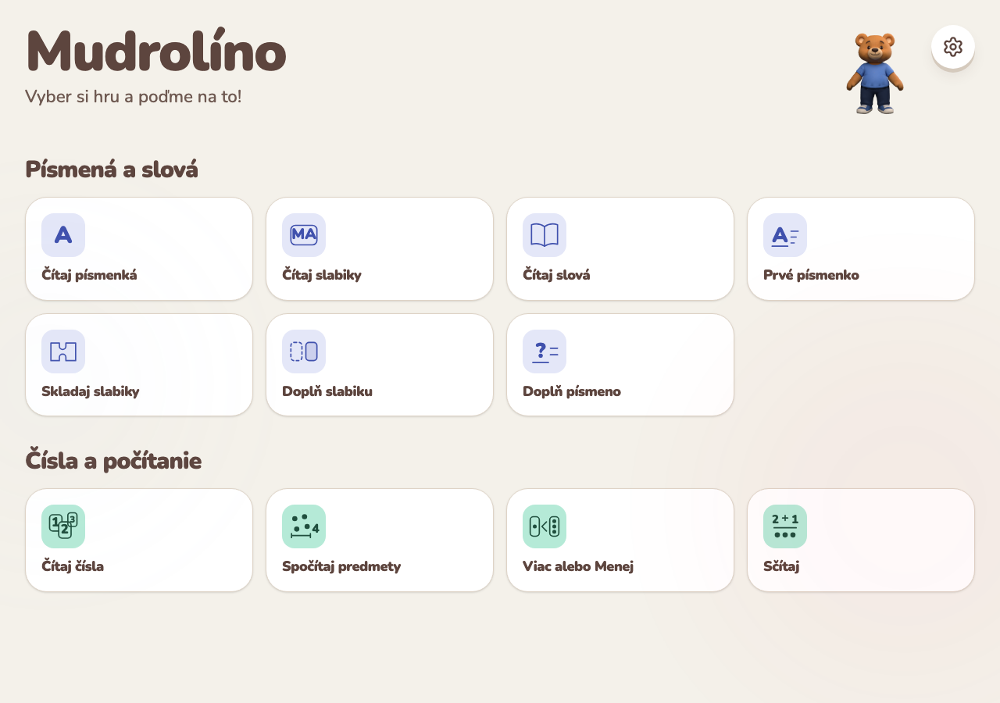
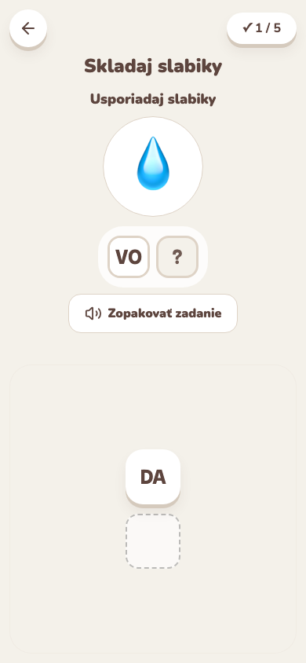
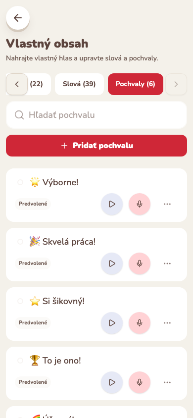

# Mudrolíno

**Make a little screen time a moment of discovery.** Mudrolíno combines playful learning with a parent's familiar voice, inviting children to participate, explore, and learn.

An educational web app for preschoolers, with eleven touch-friendly games, spoken instructions, parent-recorded audio, and printable worksheets. Built with React and TypeScript; family content stays on the device.

**[Try Mudrolíno](https://mudrolino.vercel.app)** · [Engineering decisions](docs/engineering-decisions.md) · [Run locally](#run-locally)

## Why I built it

I built Mudrolíno for my son. He loves playing—and keeps learning faster than I can add new challenges. The app is also used by a small circle of close friends, and I'm preparing to share it more widely.

We try to limit our children's screen time. When a screen is part of the day, I want it to offer something they can take part in. Letting a parent record the instructions and encouragement began as my hypothesis about making that experience more personal.

## A look inside



| Build a word from syllables | Record familiar encouragement |
| --- | --- |
|  |  |

Screenshots show the Slovak UI. [Capture provenance](docs/images/manifest.json) records the source revision, build mode, seed, and viewport for each image.

## What the app offers

- **Eleven games** covering letters, syllables, words, counting, quantity comparison, and addition. A game card starts play directly; instructions are spoken so children can participate before they can read.
- **A parent's own voice:** record prompts and praise, add custom words, and adjust game settings behind an arithmetic parent gate. Custom recordings take priority over bundled audio and speech synthesis.
- **Local-first family content:** words and settings use local storage; recordings use IndexedDB. Export and merge-restore backups to move them between devices, without accounts or automatic cloud sync.
- **An installable PWA:** core games work offline after caching. The optional 3D bear has a bundled still for reduced motion, offline use, or unavailable rendering.
- **Printable worksheets:** generate A4 activities from six games, using the same settings and content rules as on screen; print them or download a PDF.
- **Slovak and Czech:** switch language in the parent area, with first-run browser detection. Czech copy/content review and bundled recordings remain in progress; missing clips fall back to speech synthesis in the active language.

<details>
<summary>All eleven games</summary>

| Game | Activity |
| --- | --- |
| Čítaj písmenká | Hear a letter and find its card. |
| Čítaj slabiky | Hear a syllable and identify it. |
| Čítaj slová | Match a syllabified word to a picture. |
| Prvé písmenko | Choose the first letter of a spoken word. |
| Skladaj slabiky | Arrange syllable tiles to build a word. |
| Doplň slabiku | Choose the missing syllable. |
| Doplň písmeno | Fill the missing letters in order. |
| Čítaj čísla | Hear a number and find its numeral. |
| Spočítaj predmety | Count objects and choose the number. |
| Viac alebo Menej | Compare two quantities. |
| Sčítaj | Add two groups of objects. |

</details>

## How I build it

**Mudrolíno is developed entirely with coding agents.** I direct the product, define design and quality constraints, and evaluate the resulting experience through testing and use. Agents implement the code and supporting tooling.

As features accumulated, the controls and implementation became inconsistent. I pushed for shared components and a consistent design system, kept accounts in the backlog to make the initial scope achievable, and introduced automated quality checks to support continued development.

| Decision | What it means in this project |
| --- | --- |
| Reuse controls across games | Shared UI primitives, a common game shell, and a development component gallery keep styling, interaction, and accessibility behavior aligned. |
| Keep the first version local-first | No account setup or application backend for family content; explicit backups cover transfers while automatic sync remains future work. |
| Check behavior before accepting changes | Unit tests cover session/audio/data rules; browser profiles cover interaction, layout, accessibility, persistence, and offline behavior. |
| Evaluate generated 3D assets in the app | Meshy supplied the accepted bear model and rig; unsuitable stock motion was replaced with Blender-authored animation. The renderer stays lazy and optional. |

The [engineering case study](docs/engineering-decisions.md) explains the tradeoffs, rejected approaches, and links to implementation and tests.

## Stack and code map

React 19 · TypeScript · Vite · Tailwind CSS v4 · Radix UI · Motion · React Router · Three.js / React Three Fiber · Vitest · Playwright / axe-core · vite-plugin-pwa

| Area | Entry point |
| --- | --- |
| Routes and parent area | [`src/App.tsx`](src/App.tsx) |
| Game registration and shared grid-game loop | [`gameCatalog.tsx`](src/shared/gameCatalog.tsx), [`FindItGame.tsx`](src/shared/components/FindItGame.tsx) |
| Session lifecycle and timing | [`gameSessionController.ts`](src/shared/game/gameSessionController.ts) |
| Shared controls and component gallery | [`src/shared/ui/`](src/shared/ui/), [`src/shared/game/`](src/shared/game/) |
| Localized content and audio playback | [`contentRegistry.ts`](src/shared/contentRegistry.ts), [`audioManager.ts`](src/shared/services/audioManager.ts) |
| Backup and merge rules | [`src/shared/services/userData/`](src/shared/services/userData/) |
| Companion and lazy 3D renderer | [`src/avatar/`](src/avatar/) |
| Worksheets and PWA configuration | [`src/worksheets/`](src/worksheets/), [`pwaConfig.ts`](src/pwa/pwaConfig.ts) |

## Run locally

Use Node.js **22 (22.12+)**, **24**, or **26+** and npm.

```bash
npm ci
npm run dev
```

Open [localhost:3000](http://localhost:3000). The dev server binds to `0.0.0.0`, so it is also reachable on the local network. No credentials are needed to play the core games.

Optional feedback and production monitoring settings are documented in [`.env.example`](.env.example). The published bear loads from Vercel Blob; editable 3D sources are stored separately in private R2 and are only needed for asset authoring. See the [avatar workflow](docs/avatar-workflow.md).

For browser checks, install the matching browsers once after `npm ci` or a Playwright upgrade:

```bash
npm run setup:browsers
```

## Verification

| Command | Scope |
| --- | --- |
| `npm run lint` | TypeScript checks and ESLint. |
| `npm run test:unit` | Behavioral unit tests for sessions, audio, data, policies, and tooling. |
| `npm run verify:edit` | Lint, unit, pure checks, and audio inventory; selects browser suites from changed files. |
| `npm run verify:integration` | Functional browser contracts, representative geometry, development lifecycle, and production build/bundle checks. |
| `npm run verify:release` | Integration plus the full viewport matrix, WebKit, real media, offline/production checks, and strict audio inventory. |
| `npm run build` | Production output in `dist`; test builds use `dist-e2e`. |

**Current release limitation:** bundled recordings are still pending. Development accepts only the declared omissions and uses TTS fallback; strict audio/release verification remains failing until every recording is present. Earlier releases have explicit, recorded exceptions. A passing development profile does not establish release readiness.

Verification reports and traces stay under ignored artifact directories. Screenshot capture uses a seed and produces originals, review copies up to 320px wide, and a manifest:

```bash
# Against a running test-build preview:
npm run shots -- --base=http://127.0.0.1:4173 --seed=42 --scene=assembly-placed --viewport=phonePortrait
```

## Next experiments

The bear is a working proof of concept for learning the 3D model and animation pipeline. The longer-term hypothesis is a tutor with a parent's face and dress-up interactions. Parent avatars, wardrobe selection, rewards, and possible paid customization remain future work.

See the [roadmap](ROADMAP.md) for current priorities and decision history, the [engineering case study](docs/engineering-decisions.md) for the reasoning behind the implementation, and [AGENTS.md](AGENTS.md) for contribution and verification conventions. When changing shared controls, update their `/ui-kit` examples too; that gallery is available in development and test builds.
