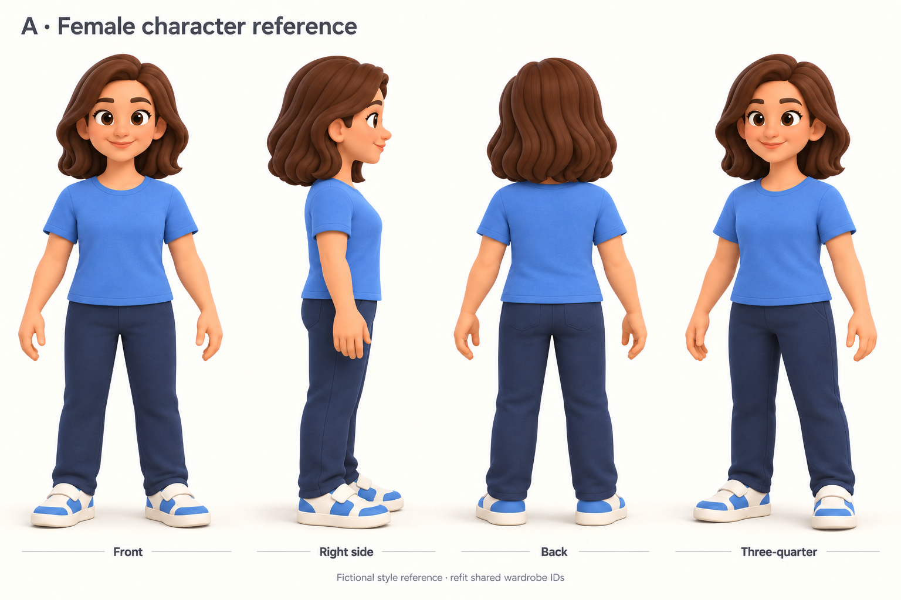
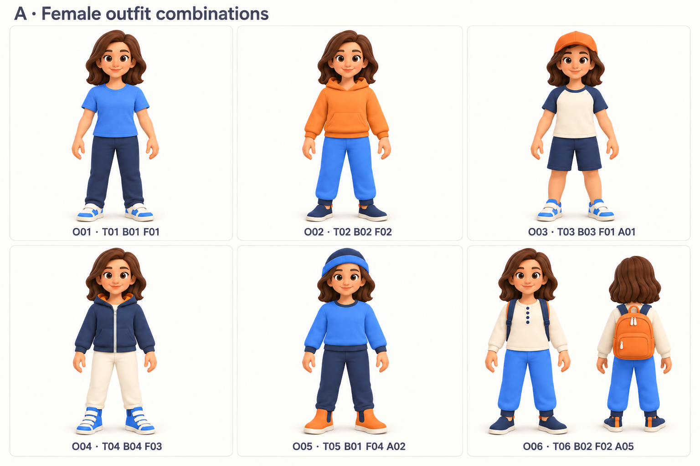
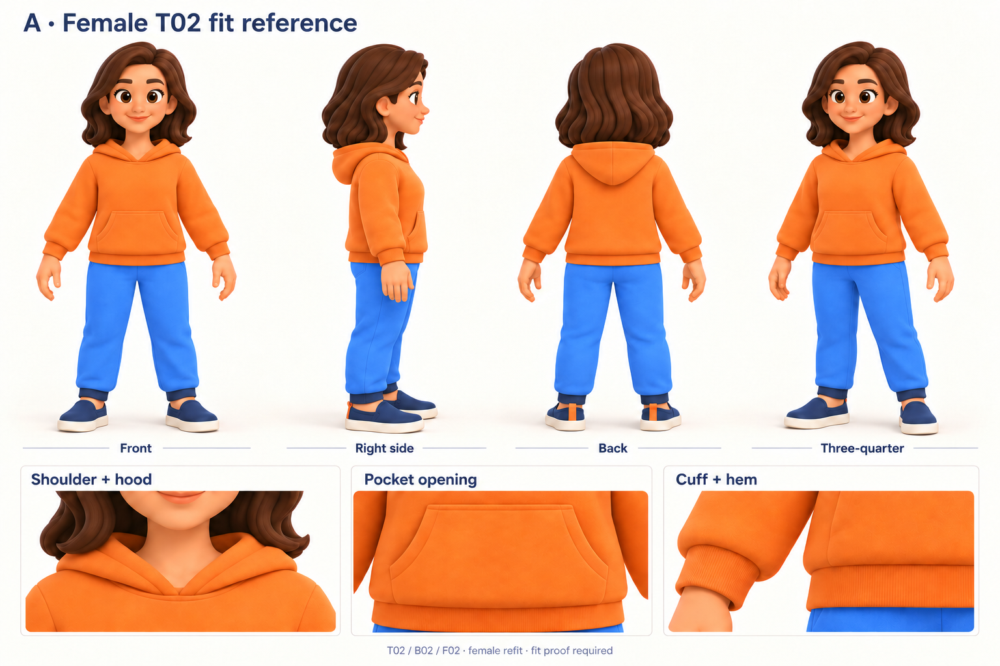
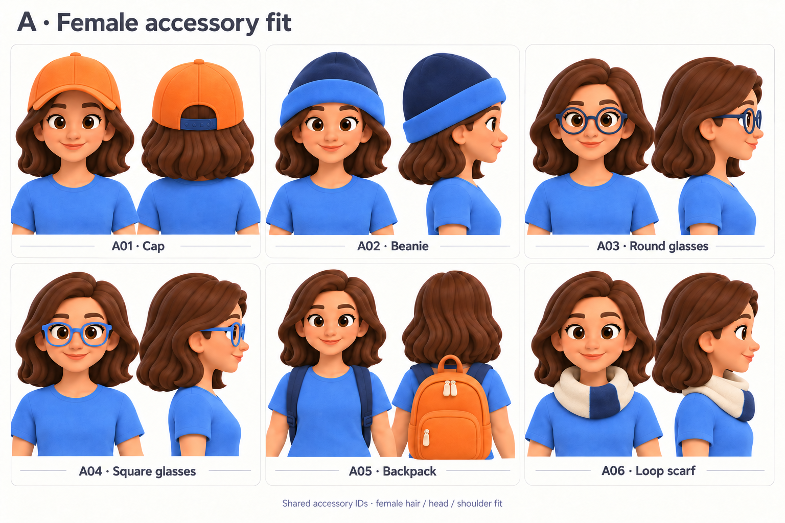

# Palette A — female avatar reference catalog

Generated 2026-10-04 with the built-in image generation tool. Four sheets extend
the existing palette-A catalog to a fictional adult female companion. The
turnaround is the shared identity/proportion guide; wardrobe and accessory IDs
remain the same as the [original catalog](../catalog-a/gallery.md).

## Character turnaround

H02-inspired broad brown shoulder-length hair, warm skin, rounded matte forms,
large expressive eyes and an average adult build. Comfortable T01/B01/F01 fit
establishes the female scaffold silhouette. Keep head/body scale and identity
consistent across views. No jewelry or additional fashion categories are implied.

The illustrated face is a fictional placeholder. Product personalization remains
a generated **2D face texture on a reusable UV-mapped head**. These pictures do
not prove selfie likeness or require personalized 3D head generation.

## Shared wardrobe on the female base

| Outfit | Pieces | Construction to preserve |
| --- | --- | --- |
| O01 | T01 B01 F01 | Blue crew tee, navy straight trousers, blue/ivory one-strap sneakers |
| O02 | T02 B02 F02 | Orange pullover/kangaroo pocket, blue joggers/navy cuffs, navy slip-ons/orange tabs |
| O03 | T03 B03 F01 A01 | Ivory/navy raglan, navy shorts, one-strap sneakers, orange cap |
| O04 | T04 B04 F03 | Navy zip hoodie/orange lining, ivory trousers, three-strap blue high-tops |
| O05 | T05 B01 F04 A02 | Blue sweatshirt/navy trim, navy trousers, orange boots/navy panels, navy/blue beanie |
| O06 | T06 B02 F02 A05 | Ivory henley/four navy buttons, blue joggers/navy cuffs, navy slip-ons, orange backpack |

These guide fit and relative scale. Original category sheets remain authoritative
for construction. The female versions need separate fitted geometry and masks;
changing colors or applying a uniform scale to male clothing does not establish fit.

## T02 hoodie fit and construction

Four full-body views plus shoulder/hood, pocket and cuff/hem details. Preserve
comfortable chest/shoulder/hip ease, high-hip hem and lowered hood. Hair/hood
separation is a fitting requirement, with complete motion checks still needed.
The first generated draft made B02 too dark; a focused edit restored blue fabric
and navy cuffs in every view. The draft is retained under `drafts/` as evidence.

## Accessories worn

Paired views of A01–A06 show hair/head/ear, shoulder and neck placement. The
backpack's carry loop is orange; its straps are navy. The cap's rear strap is
navy. A03 uses navy round frames; A04 uses blue soft-square frames. A correction
restored colors and softened rectangular frame outlines; for exact frame shape,
use the original A04 object sheet, since the worn views remain more rounded.

H02/H03 [head turnarounds](../catalog-a/13-head-turnarounds.png) remain the existing
hair construction guide. Alternative hair is not a change to the wardrobe IDs.

## Claude modeling handoff

Start in the `feature/avatar-catalog` worktree. Read
`docs/avatar-workflow.md`, the shared Blender skill and
`tools/blender/catalog/README.md` before modeling. Blender 5.2.2 LTS is installed
at the standard app path; the shared CLI now resolves it by default.

1. Save a separate female foundation/study under `assets/avatar/catalog-a/female/`.
   Use the turnaround's silhouette; preserve compatible bone names and a stable
   bind pose. Reconcile bone placement and walk/run motion for this base explicitly.
   Preserve original vertex indices within the new female foundation for coverage.
2. Prove a reusable texture-ready head with a canonical UV/mask and a local sample
   face. Model broad compatible H02 hair separately where practical. Preserve the
   neck seam and provide hair/headwear clearance; the fictional face is not an
   identity-specific mesh requirement.
3. Build the first fitted capsule T01/B01/F01, then T02/B02/F02. Reuse category
   construction helpers while adapting contours/weights to the female body.
   Rebuild coverage from the female body's own topology, not male indices.
4. Run independent and combined body/layer motion, openings, detail attachments,
   bilateral corrective isolation, export/material fidelity and actual browser
   checks. Add a labeled dev-viewer study once there is a GLB to inspect.
5. Write a retrospective per piece and update female progress separately. Retain
   male B03/B04/F02 repair requirements; their historical reports are not current
   fitting acceptance. Expand the rest of the female wardrobe only from a proven
   female foundation. Final female acceptance remains a separate milestone.

Generated views are visual references, not measured orthographic projections or
accepted 3D assets. Keep original garment details when multi-view images drift.
No Meshy generation or credit spend was used for this pack.

The [manifest and exact prompts](prompts-and-manifest.json) record the reference
roles, correction instructions, final image hashes and archived drafts. Use the
four top-level PNGs for modeling; `drafts/` contains superseded images.
