# Palette A — avatar reference catalog

Date: 2026-10-04. Generated using the built-in image generation tool from the
user-selected [Bright and friendly reference](../a-bright-friendly.png).

Sixteen sheets establish the shared reference style: cornflower blue, tangerine
orange, muted navy, ivory; rounded matte forms; comfortable casual garments;
stylized adult proportions and expressive Genmoji-like faces.

The catalog contains 20 wardrobe/accessory concepts, six fictional face/hair
studies, and four views of the original character. IDs below identify concepts,
not implemented runtime catalog entries.

## Tops — T01–T06

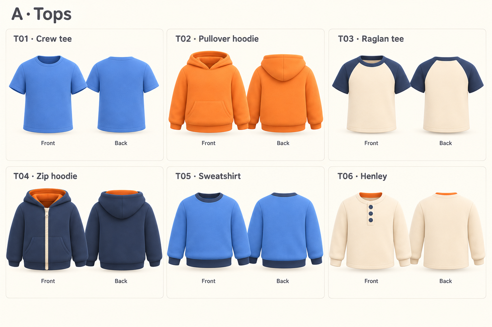

| ID | Reference design |
| --- | --- |
| T01 | Blue crew-neck tee |
| T02 | Orange pullover hoodie |
| T03 | Ivory/navy raglan tee |
| T04 | Navy zip hoodie with orange lining |
| T05 | Blue crew sweatshirt with navy trim |
| T06 | Ivory long-sleeve henley |

## Bottoms — B01–B04

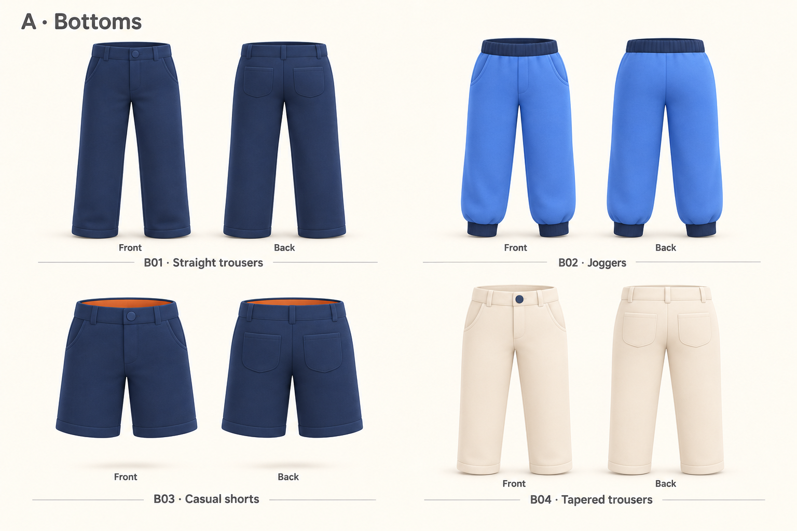

| ID | Reference design |
| --- | --- |
| B01 | Navy straight trousers |
| B02 | Blue joggers with navy cuffs |
| B03 | Navy casual shorts |
| B04 | Ivory casual trousers |

## Footwear — F01–F04

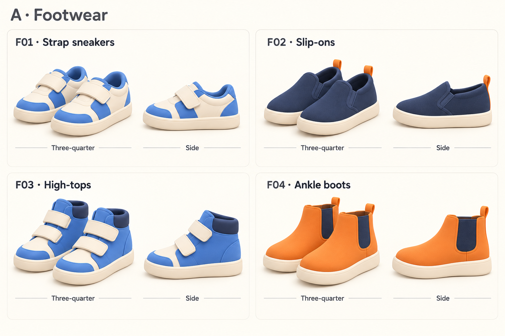

| ID | Reference design |
| --- | --- |
| F01 | Original blue/ivory strap sneakers |
| F02 | Navy slip-ons with orange heel tabs |
| F03 | Blue high-tops with three ivory straps |
| F04 | Orange ankle boots with navy side panels |

## Accessories — A01–A06

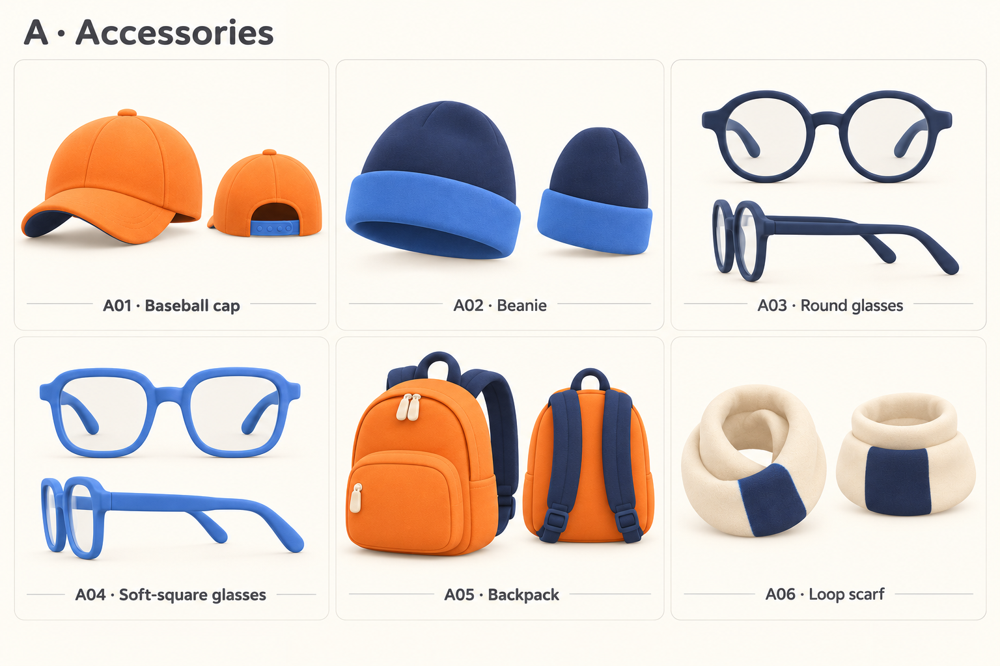

| ID | Reference design |
| --- | --- |
| A01 | Orange baseball cap |
| A02 | Navy/blue beanie |
| A03 | Navy round glasses |
| A04 | Blue soft-square glasses |
| A05 | Orange backpack with navy straps |
| A06 | Ivory loop scarf with navy panel |

## Character proportions and fit

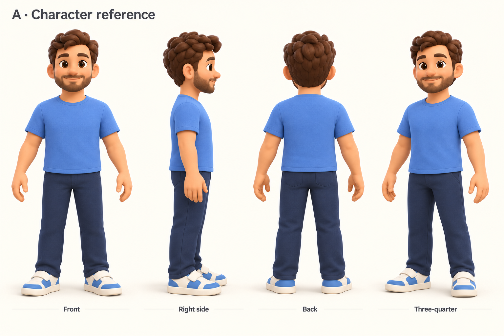

The original guide wears T01, B01 and F01. These four views establish the intended
head/body proportions, garment ease, hem positions and shoe scale. They are
visual references, not dimensionally guaranteed orthographic blueprints.

## Face and hair studies — H01–H06

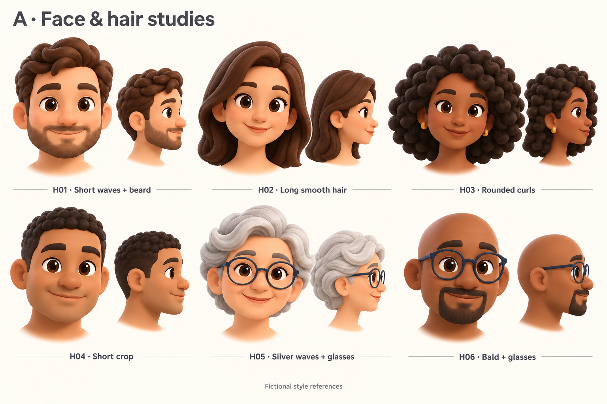

| ID | Reference study |
| --- | --- |
| H01 | Original short waves and beard |
| H02 | Smooth shoulder-length hair |
| H03 | Rounded dark curls |
| H04 | Short dark crop |
| H05 | Silver waves and round glasses |
| H06 | Bald head, goatee and glasses |

These fictional studies illustrate the visual range for future selfie
personalization. They do not test actual selfie likeness preservation or the
face-to-3D integration.

## Outfit combinations — O01–O06

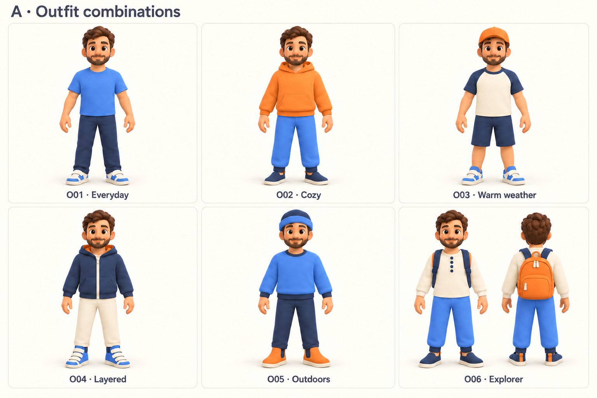

| ID | Existing catalog pieces |
| --- | --- |
| O01 | T01, B01, F01 |
| O02 | T02, B02, F02 |
| O03 | T03, B03, F01, A01 |
| O04 | T04, B04, F03 |
| O05 | T05, B01, F04, A02 |
| O06 | T06, B02, F02, A05 |

These combinations show relative garment lengths, shoe scale, hat fit and
backpack placement on the shared character. A focused correction brought F03
back to three straps and T06 to four buttons, matching the original pictured
catalog designs. The original category sheets remain the construction baseline.

## Face expressions — E01–E06

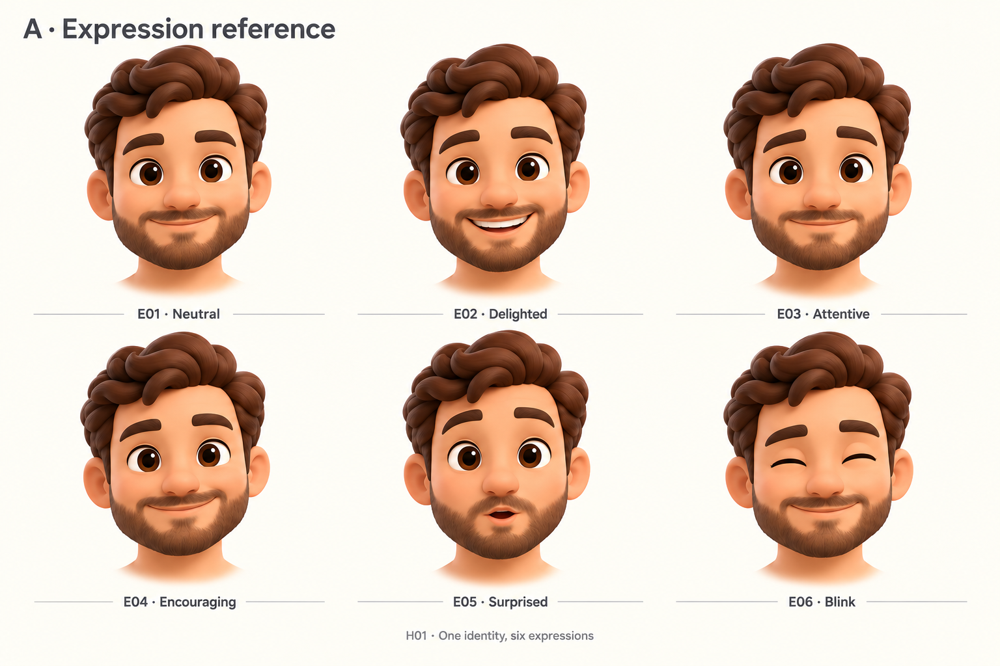

Neutral, delighted, attentive, encouraging, surprised and blink expressions
provide a starting reference for H01 facial deformation. Attentive and
encouraging are intentionally subtle. These portraits establish visual targets;
they do not validate expression topology, rigging or selfie likeness.

## T02 hoodie construction

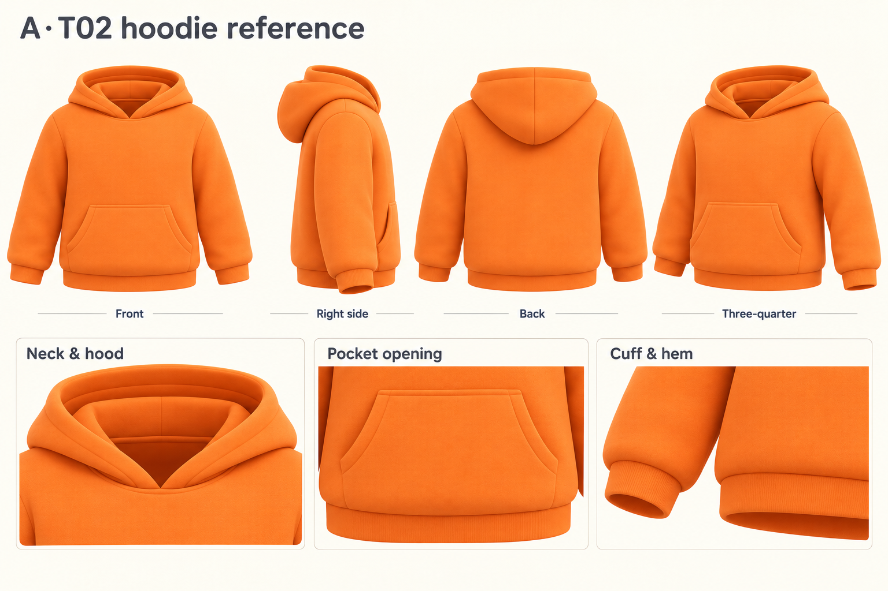

Front, side, back and three-quarter views explain the lowered hood, kangaroo
pocket, rounded cuffs and hem. Closeups clarify the same garment's construction.
Use this to settle modeling details on the shared body; generated views still
need dimensional reconciliation and animated fit checks in Blender.

## Footwear construction — F03 and F04

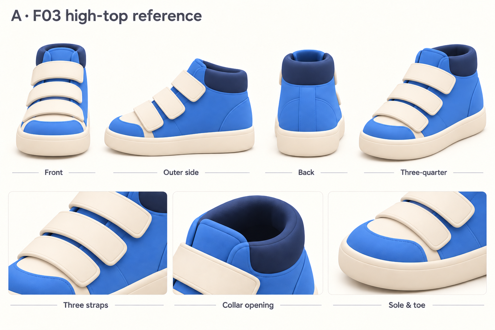

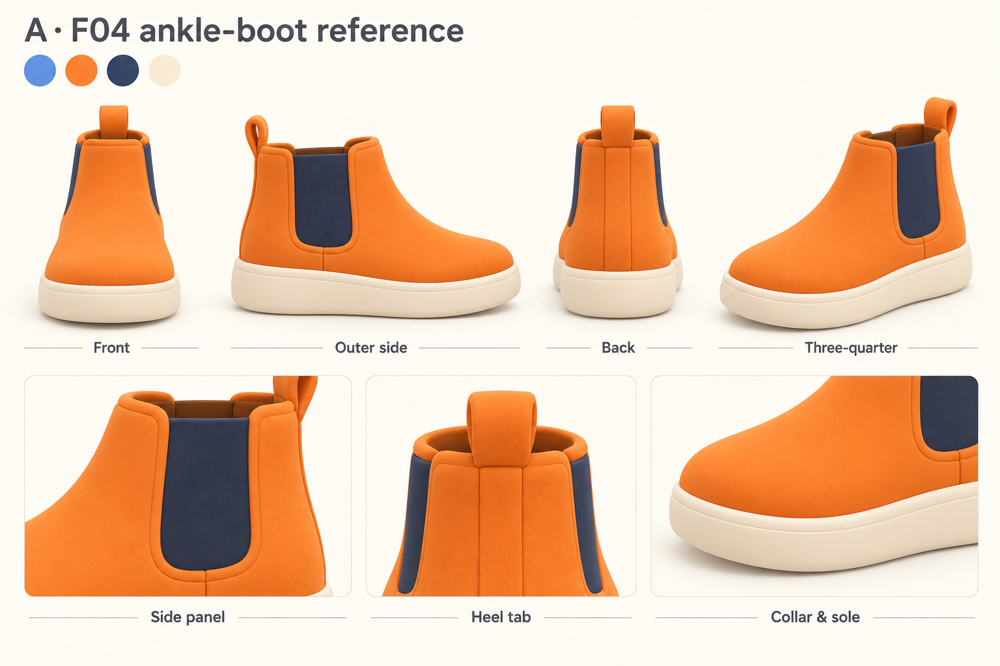

Four views and three closeups per design explain the ankle openings, sole edges,
three F03 straps, and F04 side panels and heel tab. A focused edit restored the
third F03 strap omitted by the first generated draft. Keep the original footwear
sheet as the design baseline; reconcile silhouette and dimensions on the body
in Blender rather than treating generated views as measured projections.

## Accessory placement — A01–A06

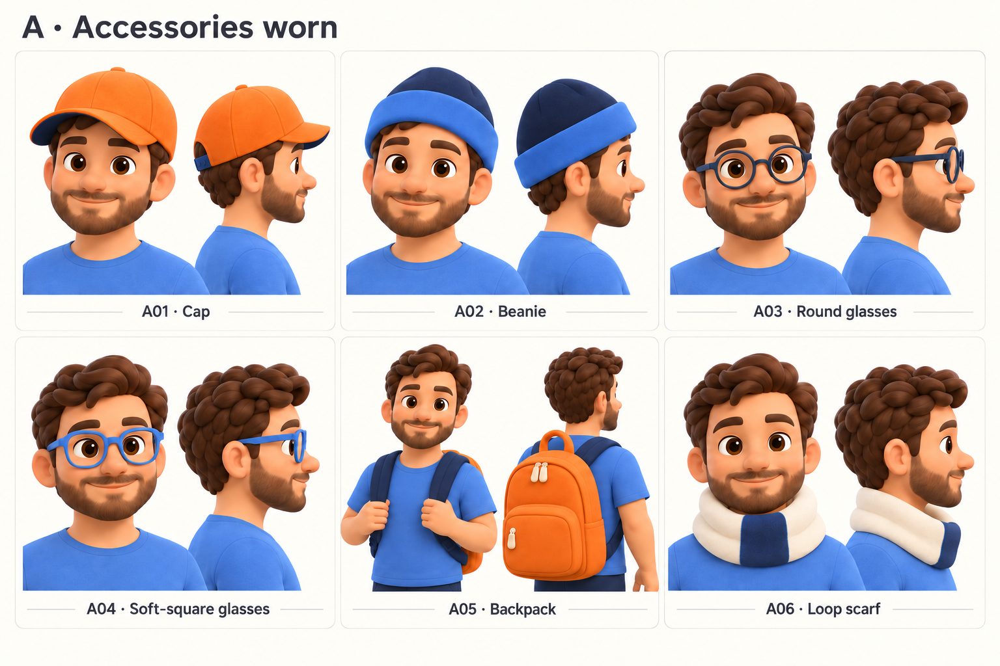

Paired views show headwear, glasses arms near the ears, scarf height and backpack
placement. The cap rear strap and backpack carry loop were corrected to their
original navy and orange colors. The category sheet remains the construction
baseline. Poses and proportions guide placement; they do not establish animated
clearance, and backpack fitting must also be checked with free arm movement.

## Head turnarounds — H02 and H03

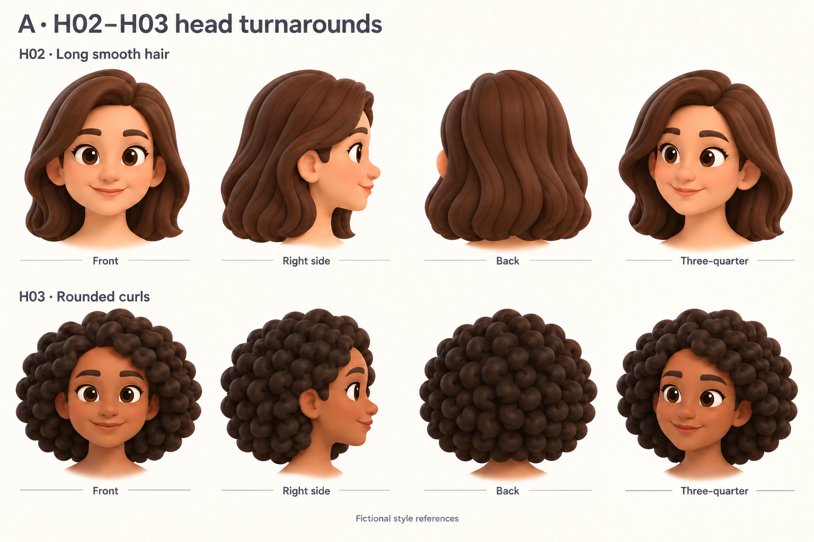

Front, right side, back and three-quarter views expand the two existing fictional
identities. Hair volume, parting, curl masses and neck boundaries provide targets
for sculpting. Generated gold earrings were removed from H03 to match the
original face study. These references do not test conversion of uploaded selfies
or prove that the resulting 3D heads preserve a user's likeness.

## Accessory construction — A02, A05 and A06

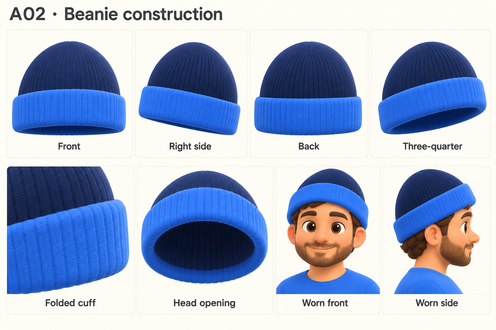

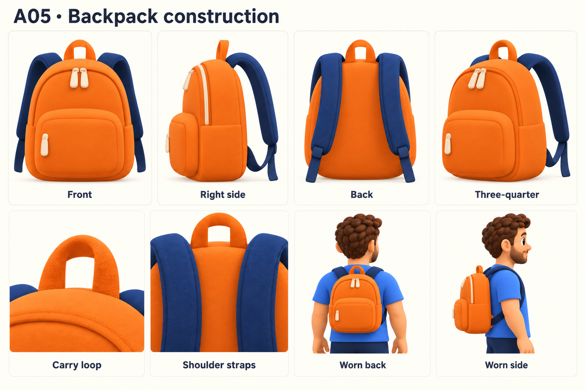

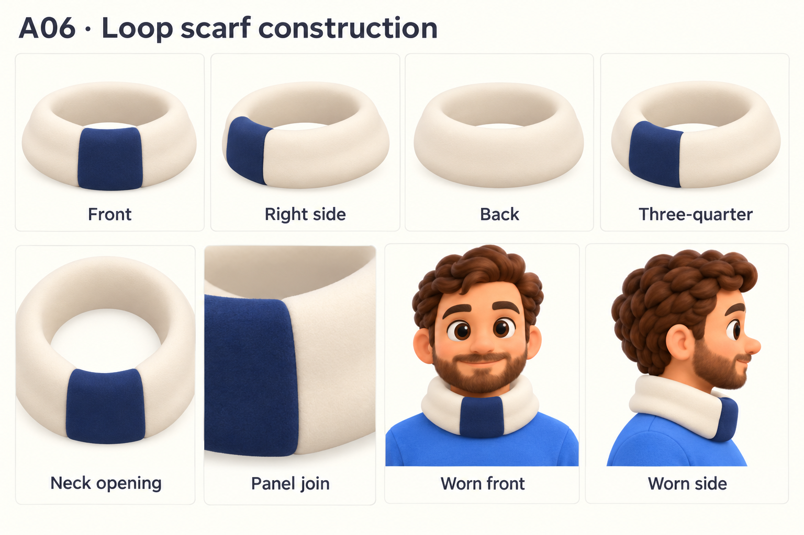

Each sheet adds four empty-object views, two construction details and two worn
views for an existing accessory. Preserve the navy dome/blue folded cuff,
orange carry loop/navy shoulder straps, and ivory scarf/navy front panel.
These references clarify openings and attachment routes; Blender fitting must
still reconcile dimensions and check head, shoulder, arm and neck movement.

## Using this catalog for 3D work

Start with a small capsule: T01, T02, B01, F01 and A01, fitted to one canonical
body/rig. Reuse accepted garment shapes for later color variants. Keep hair in
broad sculpted masses, and simplify seams, folds and hardware at runtime scale.

For each chosen asset, confirm its construction across angles, then create
separate consistent front/side/back reference images before modeling or 3D
generation. Do not feed these combined catalog sheets as single-object Meshy
inputs. Generated paired views may differ in small construction details; settle
those details before treating them as modeling requirements. F03 rendered three
straps despite the prompt requesting two; this catalog records the pictured
three-strap design.

The [manifest and exact prompts](prompts-and-manifest.json) preserve the source
reference, image filenames, concept IDs and generation instructions. Original
generated PNGs have been copied into this folder. No app-facing 3D models or
runtime catalog entries were replaced, and no Meshy commands were run.

## Female reference extension

The [female reference pack](../catalog-a-female/gallery.md) adds four sheets using
the same wardrobe/accessory IDs: a female turnaround, six outfits, T02 fit
construction and A01–A06 worn views. It includes the Claude modeling handoff and
retains corrected drafts. These are references; female fitted models remain pending.
