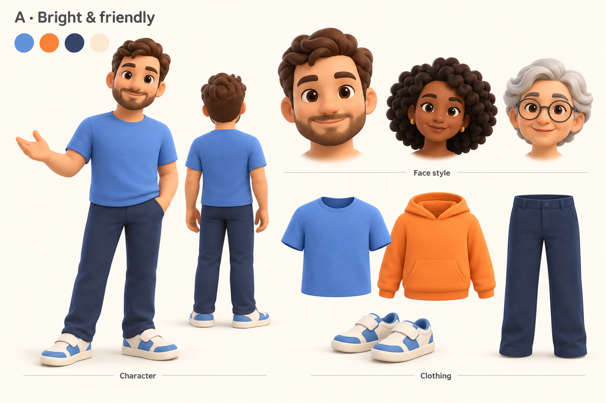
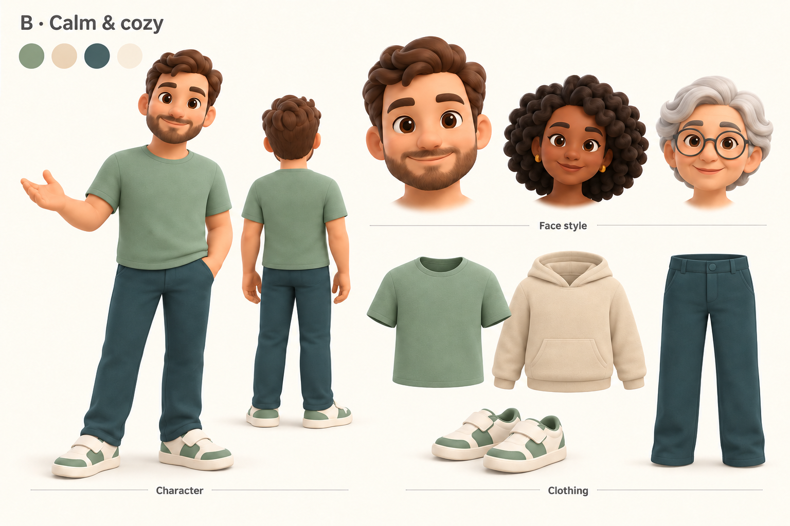
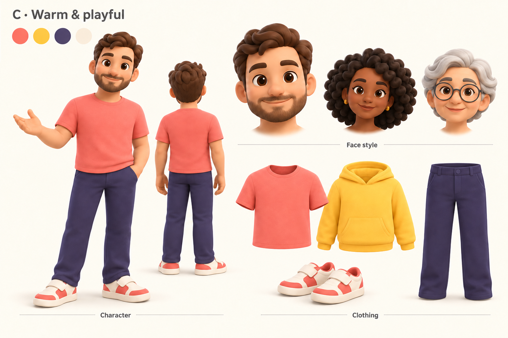

# Avatar style exploration gallery

Date: 2026-10-04. Generated with the built-in image generation tool.

User-selected direction: soft toy-like matte 3D; rounded stylized human
proportions with a slightly enlarged head; friendly adult guide; cozy casual
clothing. Future selfie personalization should retain recognizable features
while simplifying them in a Genmoji-like style.

These boards start the new art direction independently of the old avatar meshes.
The people shown are fictional face studies, not conversions of uploaded selfies.
The three palettes share the same character and garment designs so palette
preference can be judged without changing proportions or identity. The user
selected **A — Bright and friendly**. Its expanded
[reference catalog](catalog-a/gallery.md) contains 20 wardrobe/accessory designs,
six face/hair studies, and a four-view character sheet.

## A — Bright and friendly

Cornflower blue, warm orange, navy, ivory.

## B — Calm and cozy

Sage, oatmeal, dusty teal, ivory.

## C — Warm and playful

Coral, golden yellow, plum-blue, ivory.

## What comes next

Review the expanded palette-A catalog and select the first modeling assets.
Then tighten each chosen asset's separate front/side/back views before modeling.
Treat these gallery boards as art direction;
they are not orthographic modeling sheets or direct garment-generation inputs.
For a later multi-image 3D workflow, each view must be a separate image of the
same object, not this combined sheet.

Selfie customization is currently a product requirement, not an implemented or
validated conversion pipeline. A 2D face image does not by itself establish
3D hair, head geometry, rigging, or expression support. That integration will
need a separate design after the visual target is selected.

The exact generation and edit prompts are preserved in [prompts.json](prompts.json).
The original generated files were copied into this folder; app-facing 3D assets
were not replaced.
